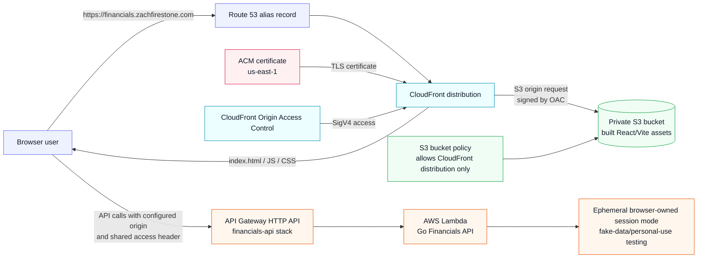

# Financials UI

A local-first frontend for the [Financials API](https://github.com/zachfire9/financials-api): a retirement planner that answers how long your money will actually last. It's a Vite + React + TypeScript app, live at [financials.zachfirestone.com](https://financials.zachfirestone.com).

## Current status

- Runtime: Vite React single-page app, deployed to S3 + CloudFront in `ephemeral` session mode
- Implemented workflows: financial-items CRUD, browser-owned ephemeral JSON sessions, JSON backup export/import, local proxy smoke testing, repository-backed or request-supplied saving/drawdown projection previews, placeholder-safe static deploy commands, SAM-managed S3/CloudFront frontend infrastructure, and optional deployed shared-token API access
- Implemented views: projection headline and summary, balance-over-time chart (total or by account), money in/out chart, and a yearly table
- Not planned unless needed: stronger identity/cloud persistence

## Repository layout

- `src/App.tsx`: accounts list and form, projection settings, session handling
- `src/ProjectionResults.tsx`, `src/charts/`: projection headline, hand-built SVG charts, yearly table
- `src/financialItemsApi.ts`: API client; `src/projectionErrors.ts`: plain-language error messages
- `src/savedSession.ts`: browser `localStorage` persistence for ephemeral mode
- `src/itemValidation.ts`, `src/numberInput.ts`, `src/format.ts`: form validation, number parsing and formatting
- `examples/`: example backup files to import (validated by `src/examples.test.ts`)
- `template.yaml`: SAM template for the S3 bucket, CloudFront distribution and security headers
- `infra/iam/`: IAM policies for the GitHub Actions deploy role (see [infra/iam/README.md](infra/iam/README.md))

## Requirements

- Node.js 22 (what CI uses; Vite 7 needs at least 20.19)
- npm 10+
- Optional for AWS infrastructure deploys: AWS CLI and AWS SAM CLI

## Local development

Install dependencies:

```powershell
npm install
```

Copy local config:

```powershell
Copy-Item .env.example .env
```

Then edit `.env` if your local API is not available at `http://localhost:8080`. Keep real machine-specific addresses, hostnames, and private runtime values out of commits. For static AWS hosting, copy `.env.production.example` to ignored `.env.production` instead of putting deployed values in `.env.example`.

Session modes:

- `VITE_FINANCIALS_SESSION_MODE=persistent` keeps the existing API-backed financial item CRUD workflow.
- `VITE_FINANCIALS_SESSION_MODE=ephemeral` keeps accounts in the browser: they're saved to that browser's local storage until you click **Clear session**, and create/edit/delete/reorder actions don't call the financial-items API. Projections send the current accounts in the request body. Use Export JSON to back up or move to another device.

Start the Financials API from the sibling `financials-api` repo in a separate terminal:

```powershell
go run ./cmd/api
```

Start the UI dev server for same-machine browser testing:

```powershell
npm run dev:local
```

To run in ephemeral mode (what the deployed site uses) without editing `.env`, use:

```powershell
npm run dev:ephemeral
```

This loads the committed `.env.ephemeral` (Vite's "ephemeral" mode), which takes priority over your `.env`. The API still needs to be running for projections.

Example backups for trying out features live in [`examples/`](examples/README.md). Import one, enter the projection settings listed there, and calculate.

`npm run dev` and `npm run dev:local` are the same: both listen only on this machine. The local-only UI dev server listens on `http://127.0.0.1:5173` and includes a local proxy from `/api/*` to the Financials API target. Browser code calls `VITE_FINANCIALS_API_BASE_URL`, which defaults to `/api`; the dev server rewrites that to the local API during development.

## Local network smoke test

Use this checklist when testing the UI from another device on the same private network. Keep committed docs placeholder-only: Do not commit the real private IP address, hostname, firewall/router details, or real financial values.

1. Start the Financials API on the development machine with fake/example storage data only. The UI proxy target should remain local to the development machine by default:

   ```powershell
   $env:VITE_FINANCIALS_API_PROXY_TARGET="http://localhost:8080"
   ```

   This value can also live in an ignored `.env` file:

   ```env
   VITE_FINANCIALS_API_PROXY_TARGET=http://localhost:8080
   VITE_FINANCIALS_API_BASE_URL=/api
   ```

2. Start the network-visible Vite dev server from this repo:

   ```powershell
   npm run dev:network
   ```

3. From the other device, open the placeholder UI URL:

   ```text
   http://<dev-machine-private-ip>:5173
   ```

4. Exercise the financial-items CRUD flow with fake/example data only:

   - Load the UI and confirm the financial-items panel renders.
   - Add an example item.
   - Edit the example item.
   - Delete the example item.
   - Refresh the page and confirm the list reflects the API-backed state.

5. If the UI loads but API calls fail, verify the development machine can reach the API locally and that the UI terminal shows `/api/*` proxy requests. Keep any real network/firewall troubleshooting notes outside this public repo.

This local network smoke test intentionally keeps browser API calls behind the Vite dev proxy. Static-hosting builds use `VITE_FINANCIALS_API_BASE_URL` directly instead.

## Accounts

The accounts panel covers the `/financial-items` API contract (persistent mode) or the browser session (ephemeral mode):

- Add, edit and delete accounts. Each has a current amount, annual return, optional drawdown return (blank reuses the annual return), annual contribution, and an option to grow the contribution with inflation.
- Drag accounts to reorder them. In persistent mode only the moved accounts are saved; if a save fails partway, the list reloads the saved order.
- Export a JSON backup of the current accounts, or import one to replace them.
- Field-level validation, and plain-language messages for API and network errors.

## Projections

The projection panel calls `POST /projections`:

- Enter saving years, drawdown years, the annual withdrawal (in today's dollars) and an inflation rate. Inflation grows the withdrawal each year, and the contributions of accounts that opt in.
- Persistent mode projects the saved accounts; ephemeral mode sends the current accounts in the request body.
- Results show a headline (how long the money lasts, or the shortfall), a balance-over-time chart (total or stacked by account, with the saving/drawdown phases marked), a money in/out chart (contributions, growth, withdrawals, shortfall), and an optional yearly table.
- The last successful projection stays visible if a recalculation fails.

Not supported yet: saved scenarios and a custom withdrawal order across accounts.

Use fake/example data only while testing this public repo workflow. Real financial values belong in local/private runtime data, not committed docs or fixtures.

## Static AWS hosting

Use this workflow for a low-cost S3 + CloudFront static deploy. Keep real bucket names, CloudFront distribution IDs, deployed API URLs, API keys, and custom domains out of committed files unless you intentionally decide they are public-safe.

The deployed backend API must already exist from the sibling `financials-api` SAM stack. Static hosting should use `ephemeral` session mode until stronger identity/cloud persistence exists; use fake data only with the shared-token gate, and do not use real financial data until you are comfortable with the deployed protection model.

1. Copy the production placeholder config locally:

   ```powershell
   Copy-Item .env.production.example .env.production
   ```

2. Edit `.env.production` with your deployed API Gateway base URL, ephemeral mode, and the shared token configured on the matching API stack:

   ```env
   VITE_FINANCIALS_API_BASE_URL=https://<api-id>.execute-api.<aws-region>.amazonaws.com
   VITE_FINANCIALS_SESSION_MODE=ephemeral
   VITE_FINANCIALS_ACCESS_TOKEN=<private-access-token>
   ```

   `VITE_FINANCIALS_ACCESS_TOKEN` is bundled into the static files. It is a pragmatic personal-use blocker that keeps unauthenticated requests from succeeding, not true user identity or a replacement for Cognito/OIDC if the app later needs stronger auth.

3. Build the static app:

   ```powershell
   npm run build
   ```

4. Sync `dist/` to the provided frontend bucket:

   ```powershell
   .\scripts\deploy-static.ps1 -BucketName "<frontend-bucket-name>" -Profile zachfire9
   ```

5. If the site is served through CloudFront, include the distribution ID so the script requests an invalidation:

   ```powershell
   .\scripts\deploy-static.ps1 -BucketName "<frontend-bucket-name>" -DistributionId "<cloudfront-distribution-id>" -Profile zachfire9
   ```

Suggested AWS shape:

- A private S3 bucket stores the `dist/` files.
- CloudFront serves the bucket over HTTPS, with the AWS managed security headers policy (HSTS, `X-Frame-Options`, `X-Content-Type-Options`, `Referrer-Policy`).
- CloudFront Origin Access Control allows CloudFront to read from the private bucket without making the bucket public.
- SPA fallback maps CloudFront 403/404 responses to `index.html` so direct browser refreshes work.
- Configure the API stack's CORS allowed origins with the CloudFront/static site origin, using deploy parameters instead of committed real values.

### AWS request flow



Key points:

- Route 53 points the custom domain at CloudFront; CloudFront uses the ACM certificate for HTTPS.
- CloudFront is the only public reader of the private S3 bucket; Origin Access Control plus the bucket policy keep the bucket private.
- The React app is static, so API calls still go from the browser to the sibling `financials-api` API Gateway endpoint.
- The API stack must allow the custom UI origin in CORS and must receive the shared access header configured at build time.

### SAM-managed frontend infrastructure

GitHub Actions deployment setup is documented in [GitHub Actions UI deploy](docs/github-actions-deploy.md). Every push to `master` builds, tests and syncs the site; with the `DEPLOY_FRONTEND_INFRA` repo variable set to `true`, it also runs `sam deploy` for this template. The workflow uses AWS OIDC and GitHub Secrets/Variables so deploy credentials and build-time tokens stay out of git. The manual steps below are for one-off or first-time setup.

This repo includes `template.yaml` for creating the low-cost frontend hosting resources with SAM/CloudFormation. The template creates:

- a private S3 bucket for built files
- a CloudFront Origin Access Control
- a CloudFront distribution
- optional custom-domain aliases when `CustomDomainName` and `CertificateArn` are supplied
- optional Route 53 A/AAAA alias records when `CustomDomainHostedZoneId` is supplied
- a bucket policy allowing CloudFront read access only
- SPA fallback behavior for browser routes
- stack outputs for the bucket name, distribution ID, CloudFront domain, default CloudFront URL, and optional custom-domain URL

Validate the template if SAM is installed:

```powershell
npm run infra:validate
```

Create the frontend infrastructure with guided SAM deploy:

```powershell
npm run infra:deploy
```

Use `zachfire9` for the AWS profile when prompted by SAM. Leave `SiteBucketName` blank if you want CloudFormation to generate a bucket name, and keep `PriceClass_100` for the lowest-cost CloudFront edge-location default.

If you prefer running SAM directly:

```powershell
sam deploy --guided --profile zachfire9
```

`samconfig.toml` is ignored so real local stack settings stay out of git. `samconfig.example.toml` is a placeholder-safe reference if you want to copy it locally.

To manage a custom domain such as `financials.zachfirestone.com` through the frontend stack, first create and validate an ACM certificate for that domain in `us-east-1`; CloudFront cannot use certificates from other regions. Then deploy with private/local parameter values, not committed docs:

```powershell
sam deploy --profile zachfire9 --parameter-overrides PriceClass=PriceClass_100 CustomDomainName="<custom-domain>" CertificateArn="<us-east-1-acm-certificate-arn>" CustomDomainHostedZoneId="<route53-hosted-zone-id>"
```

In the GitHub Actions workflow, the custom domain comes from the `CUSTOM_DOMAIN_NAME` and `CERTIFICATE_ARN` repo variables. Set it there or in the stack, never by hand in the CloudFront console: a domain added by hand isn't part of the stack, and the next infra deploy removes it.

`CustomDomainHostedZoneId` is optional. If it is blank, the stack configures the CloudFront alias and certificate only; create the Route 53 A/AAAA alias records separately. If it is supplied, the stack creates A and AAAA alias records that point the custom domain at the CloudFront distribution. Keep certificate ARNs, hosted zone IDs, stack names, real deployed domains, API URLs, and tokens in ignored local config or private operator notes unless you intentionally decide they are public-safe.

When serving the UI from a custom domain, update the sibling API stack's CORS parameter so `FinancialsAllowedOrigins` includes the custom origin, for example `https://<custom-domain>`. During migration you can include both the generated CloudFront URL and the custom domain as a comma-separated value.

After the stack deploys, inspect the outputs:

```powershell
aws cloudformation describe-stacks --stack-name "<frontend-stack-name>" --profile zachfire9 --query "Stacks[0].Outputs" --output table
```

Use the stack outputs to deploy the current build assets:

```powershell
$bucket = aws cloudformation describe-stacks --stack-name "<frontend-stack-name>" --profile zachfire9 --query "Stacks[0].Outputs[?OutputKey=='FrontendBucketName'].OutputValue | [0]" --output text
$distributionId = aws cloudformation describe-stacks --stack-name "<frontend-stack-name>" --profile zachfire9 --query "Stacks[0].Outputs[?OutputKey=='FrontendDistributionId'].OutputValue | [0]" --output text
npm run build
.\scripts\deploy-static.ps1 -BucketName $bucket -DistributionId $distributionId -Profile zachfire9
```

Custom domain resources are optional. The generated CloudFront URL from `FrontendUrl` remains valid even when `FrontendCustomDomainUrl` is also present.

Amplify Hosting remains a possible later migration if GitHub-connected deploys become worth the extra abstraction.

## Build and test

Run unit tests:

```powershell
npm test
```

`src/docsPrivacy.test.ts` fails if a private IP address or LAN (mDNS) hostname appears in `README.md` or `.env.example`.

Build the static app:

```powershell
npm run build
```

The production build is written to `dist/`, which is the directory to sync to the static S3 bucket or preview locally.

## Public repo boundaries

This repo is public, so committed files must not contain:

- Real financial data
- Secrets, API keys, passwords, or tokens
- LAN IPs, hostnames, router/firewall details, or machine names
- Environment-specific production configuration

Use placeholders in committed docs and `.env.example`; keep real local values in ignored `.env` files.
